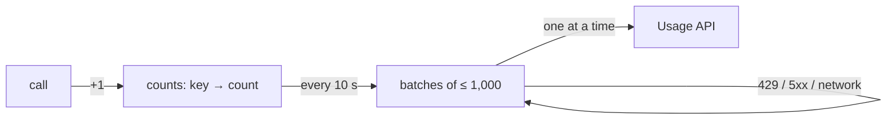

# Usage SDK specification

How every Update Prompt usage SDK behaves, whatever the language, so they all report the same way. This Go SDK is the reference.

**Keep the SDK simple.** It collects facts and sends them. Validation, normalisation, limits and every other rule live in the Update Prompt services. When in doubt, leave it out of the SDK.

## Purpose

An SDK does two jobs inside an API:

1. **Count calls** per endpoint, consumer and minute, and send the counts to the Usage API.
2. **Apply deprecation signals** (coming): copy the headers and refusals the signals document gives.

Everything an SDK does is also possible with the public [Usage API](https://updateprompt.com); the SDK only saves writing it. Counting per minute keeps the network and memory use small, whatever the traffic.

| The SDK does | The SDK does not |
|---|---|
| Count calls: method, host, route (or raw path), consumer id, query parameter names, minute | Send bodies, header values, query values, IPs, status codes or latency |
| Send counts in batches and retry when the API asks | Send one request per call |
| Take the route from the router, the consumer id from the application | Authenticate consumers, define endpoints, or guess ids |
| Drop counts rather than slow the application | Block, slow or fail a request, or grow memory without bound |
| Pass values as they are | Validate, clean or normalise them |
| Expose three counters and an optional logger | Collect metrics, traces or logs |
| Use public, documented endpoints only | Ship keys or secrets, use private endpoints, or call home on start |

## 1. Configuration

| Setting | Default |
|---|---|
| API key | `UPDATE_PROMPT_API_KEY`. Missing: the SDK does nothing and logs once; the application keeps running |
| Base URL | `https://usage.updateprompt.com` (`UPDATE_PROMPT_URL` overrides it, for tests) |
| Consumer id | Set per request by the application, or a function. Unset means no consumer id |
| Route | From the framework, or a function |

The send interval and the memory limit are constants, not settings.

## 2. One call

| Field | Value |
|---|---|
| `method`, `host` | As received |
| `route` | The router's template, such as `/orders/{id}`, sent to `POST /v1/usage` |
| `path` | The raw path, only when there is no template, sent to `POST /v1/usage/paths`, followed by `?` and the query parameter names (escaped, no values) |
| `consumer` | As set by the application, or left out |
| `queryParams` | Names from the query string, decoded, in order (route reports only) |
| `timestamp` | When the request started, rounded down to the minute, UTC |

The one rule in the SDK: a call with **no template that answered 404** isn't counted, so scanners don't create endpoints. Only the SDK knows the status.

## 3. Counting and sending

| Rule | Value |
|---|---|
| Key | Every field of §2, minute included |
| Send | Every 10 s ±20% jitter: take the counts, start new ones, and split them into batches of at most 1,000 reports and under 1 MB, one endpoint per batch |
| In flight | One request at a time, oldest batch first |
| Memory limit | 10,000 distinct reports, counting and waiting together. When full, calls that need a new report are dropped; existing ones keep counting |
| Idempotency-Key | 128 random bits, base64url, per batch, kept on every retry |
| Timeout | 10 s per request |
| Shutdown | `close` sends what's left until the application's deadline, then drops the rest |
| Serverless | `flush` at the end of an invocation |

## 4. Answers

| Answer | The SDK |
|---|---|
| 2xx (202, 207) | Done, without reading the body |
| 429, 5xx, network error | Retries the same batch after `Retry-After` (seconds or a date), else after a backoff from 1 s doubling to 60 s, ±20% |
| Any other 4xx | Drops the batch and logs once |

The API decides everything else: invalid reports (207), reports over 24 hours old (refused, so retries end), revoked keys (401) and limits (429).

## 5. Stats and logs

`stats` returns the calls `counted`, `sent` and `dropped`. Logs are off unless the application passes a logger, with at most one line per problem an hour.

## 6. Conformance

Every SDK tests, against a fake Usage API: call to report, adding up within a minute, a new minute splitting, the memory limit, batch splitting by count and size, retries with the same Idempotency-Key, `Retry-After` in both forms, refused batches, and shutdown.
